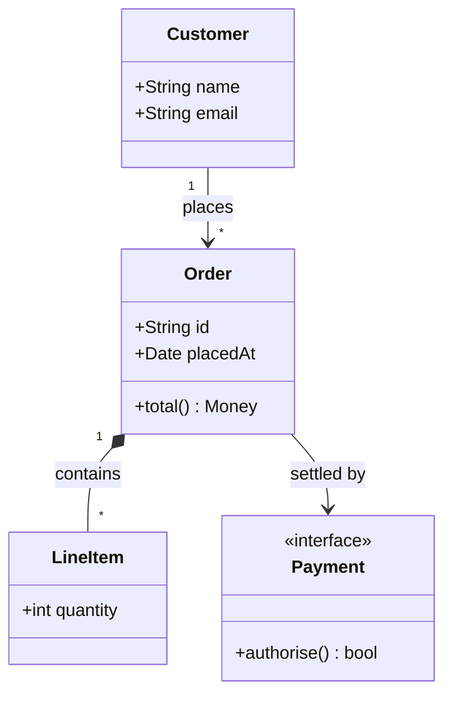
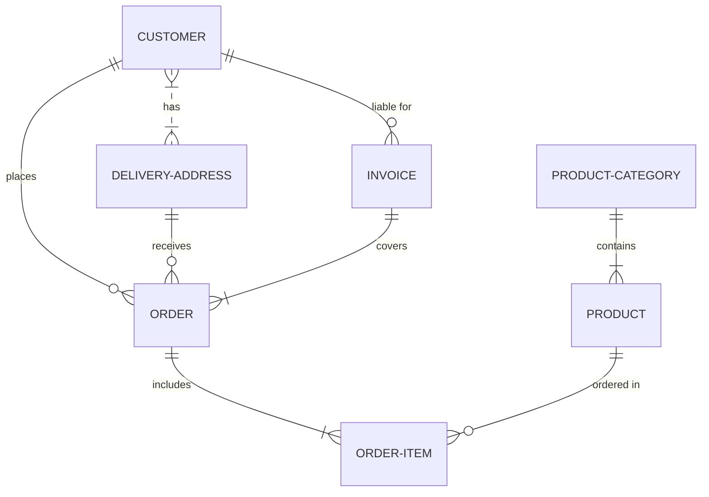
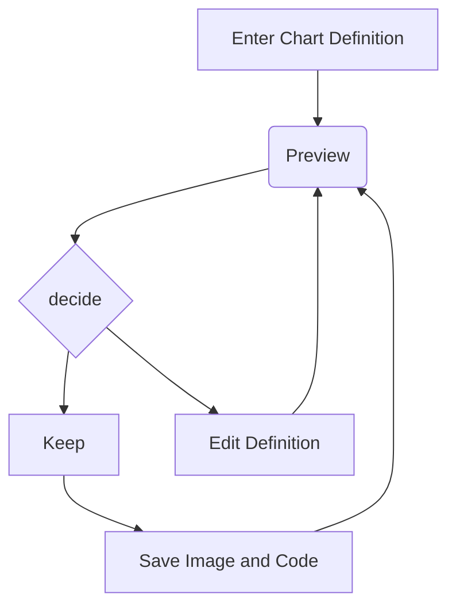

# "Ricing" Linux

    
        

            ou : Comment  une palette de couleurs  a changé ma manière  d'utiliser un ordinateur
        

    

---

## 1. Moi et linux

### Ubuntu / Gnome depuis 2005 et l'IUT

### 2021/2022, inspirations (collègues)

### 2022 clavier split + passage à i3/sway

### dev front, l'ux/ui, l'application de DS (CHARTE GRAPHIQUE), c'est ma came
---

## 2. Le ricing ? kézako?

### bases d'un système linux, pourquoi c'est possible (macos/win = gros bloc de bois, linux=kaplas)

### c'est quoi une "distribution, environnements de bureau etc...

### examples GTK / QT

### gnome-look/kde-look

### themes/.config folders (dotfiles)

### XDG / freedesktop.org
---

## 3. la fameuse palette catppuccin qui m'a fait basculer

### 2p, 2c, syntaxe, 4 déclinaisons d'ultra light à dark

### peu de contraste par défaut, mais une fois sur du noir, c'est mieux

### les multiiiiples ports

### switch de vim, vers neovim.?

### switch de i3 vers sway ?

### tout en même temps ? non!

---

## 4. essayer plein de trucs

### depuis la page d'install de neovim

### liste des plugins

### démo/explication d'une sélection de plugins
  - base de nvim / dashboard
  - telescope 
  - flash positions
  - diffview
  - neotest

### évidemment, pas que l'éditeur

### GRUB / plymouth / greeters (rapide, avant l'os)

### pour le reste de l'OS:

---

## 5. I3/Sway + bar, le plus gros changement
### c'est quoi un TWM ?

### wayland / X11 : explications rapide

### un compositeur de fenêtres ? wat ?

### y'a le choix (tour d'horizon rapide)

### démo de mon TWM

### workspaces / panneaux launcher
---

## 6. payer le prix
### tmux: les tui's c'est la vie (mais pas portable)

### neovim: nombreux plugins (trop?)

### sway: bugs avec nvidia, bugs avec displaylink (wlroots)

### passer du temps à tester, configurer

### aujourd'hui c'est mon IDE, mon OS, stable

---

## 7. Retour à moi et linux

### j'ai essayé plein de gestionnaires de fenêtres

### adoption d'une approche "minimaliste", fuck les distros, je fait la mienne

### les dotfiles, ça change la vie

### j'ai fait à la main, mais `chezmoi`/`stow`/`nix home-manager` existent

### aujourd'hui ce qu'il me manque / reste à faire: extensions shell, quickshell eww 
---

## Ce que ça a changé réèllement pour moi

### Ergonomie: les outils doivent s'adapter à l'humain, pas l'inverse

### Connaissance/Contrôle: je sais qui fait quoi, vu que je les ai configuré

### Rapidité (d'usage et d'installation)

### Est-ce une perte de temps monumentale ? (oui, un peu, mais je fais ce que je veux.)

### Retour sur mac/windows => dur, mais le ricing y est possible aussi (yabai/komorebi)
---

## Conclusions / questions

### Reprenez le contrôle sur votre OS

### Shoutout à mes anciens collègues seniors.

---
## Examples mermaid

